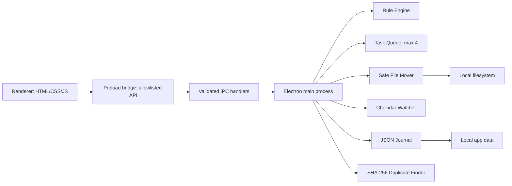

# Sanctum Keeper

A local-first Windows desktop file organizer built with Electron, HTML, CSS, JavaScript, Node.js, and Chokidar. It scans a folder, previews category destinations, organizes files, records a local journal, offers guarded Undo, monitors new files in opt-in Auto mode, and reports duplicate content using SHA-256.

## Current implementation status

Implemented in this source package: secure Electron preload boundary, top-level folder scanning, extension classification, preview and confirmation, custom prefix/extension rules, collision-safe file movement, local JSON history, hash-verified Undo, opt-in Chokidar watching, duplicate content scan, and unit tests for core rules and file operations.

Important limitation: filesystem crash recovery is conservative but not a full transactional filesystem. Test thoroughly on disposable folders. Cross-drive copy verification is implemented; platform-specific permission and network-drive behavior can vary. The application has not been verified on your Windows machine from this environment.

## Requirements

- Windows 10 or 11
- Node.js 20 LTS or newer (Node 20 recommended)
- npm

## Install and run

Open PowerShell in the project directory:

```powershell
npm install
npm test
npm start
```

Build a Windows installer (on Windows, preferably):

```powershell
npm run dist
```

Installer output is placed in `dist/`.

## First run

1. Create a disposable test folder, for example `C:\SanctumDemo`.
2. Put copies of a few PDFs, images, text files, and a ZIP into it.
3. Start Sanctum Keeper and choose that folder.
4. Click **Scan folder** and review the preview. Scanning does not move files.
5. Click **Confirm & organize** and approve the confirmation dialog.
6. Inspect the generated category folders and History & Undo.
7. Try Duplicate Finder with two copies of the same file.
8. Use Auto mode only with a dedicated test folder; it moves new files automatically.

## Architecture



- **Renderer:** presents the interface; it has no direct Node.js access.
- **Preload:** exposes a narrow `window.sanctum` API via `contextBridge`.
- **Main process:** owns file access and handles IPC requests.
- **Rule Engine:** maps file extensions and custom rules to category folders.
- **Task Queue:** limits concurrent jobs to four.
- **File Mover:** avoids overwriting by reserving destination names and verifies copied data on cross-device moves.
- **Journal:** stores planned and completed operations in a local JSON file using temp-file replacement.
- **Watcher:** Chokidar waits for file writes to settle before notifying the app.
- **Duplicate Finder:** hashes file streams instead of loading entire files into memory.

## Data and safety

Settings and history are stored in Electron's `app.getPath('userData')` directory. Use the Settings screen's local-data description as a reminder that data remains on this device; the precise folder is platform-dependent.

- The renderer has `nodeIntegration: false` and `contextIsolation: true`.
- Only selected top-level regular files are scanned by default.
- Temporary files such as `.crdownload`, `.part`, and `.tmp` are skipped.
- Duplicate Finder never deletes files.
- Undo checks the recorded SHA-256 before restoring a file.
- Use a disposable test folder before real data. File locks, network shares, antivirus software, and filesystem permissions can affect results.

## Known limitations

- No recursive scanning; only immediate files are considered.
- Custom rules currently support filename prefix and extension matching, not full glob syntax.
- Category folder names are generated within the selected folder. Avoid selecting a drive root or system folder.
- A file stability timer cannot prove that a download has completed in every application.
- A crash during a filesystem operation may require manual inspection; never assume an ambiguous operation can be safely replayed.
- Packaging and Windows-specific behavior must be tested on the target machine.

## Troubleshooting

- **`npm` not recognized:** install Node.js LTS and reopen PowerShell.
- **Electron fails to start:** run `npm install` again and check the Node.js version with `node --version`.
- **Permission denied:** use a folder you own, not a Windows system directory.
- **File skipped or failed:** inspect the error in the terminal and History screen; close programs that may lock the file.
- **No duplicate group:** the contents must be byte-for-byte identical, not merely have the same name.

## Tests

Run `npm test`. Tests use generated temporary directories and do not touch Downloads or Desktop. Passing unit tests do not replace testing the built app on Windows.
